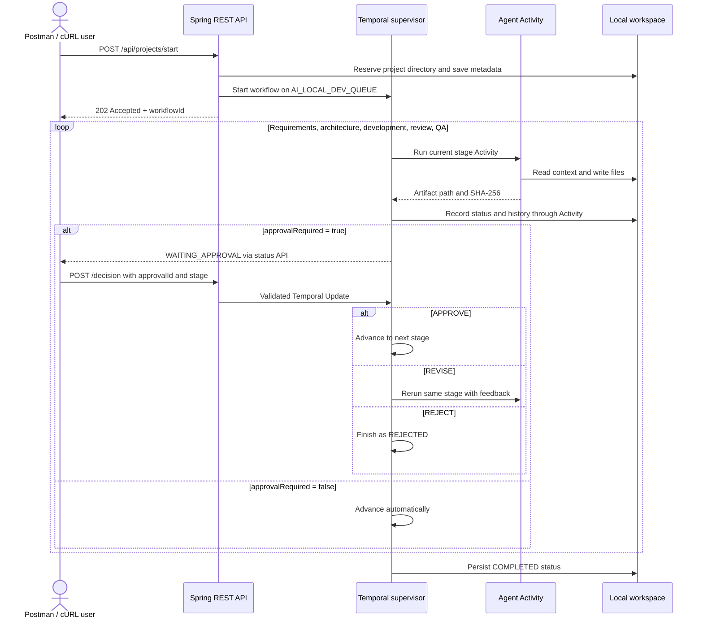

# How a project moves through the platform

This guide describes the current implementation. The project request supplies the requirements at runtime; the signup page in the examples is only sample input.

## Flow at a glance



The REST request returns after Temporal accepts the workflow; agent generation runs in the worker afterward. The API and worker are in the same Spring Boot process, while Temporal Server keeps the workflow state.

## 1. Start a project

`POST /api/projects/start` accepts `projectName`, `prompt`, optional `technology`, `approvalRequired`, and optional `workspace`. `projectName` is a safe directory name. If supplied, `workspace` must equal `projectName`; clients cannot select an absolute directory. The server chooses the root from `AI_WORKSPACE` (default `C:\AI-Development\workspace`).

The controller creates a unique ID such as `dev-signup-page-<uuid>`, reserves the project directory, saves metadata, and starts `DevelopmentWorkflow`. The response is `202 Accepted` with the ID and `STARTED`. A second request cannot reuse an existing project directory.

## 2. Run the five stages

The supervisor calls `DevelopmentActivities.runStage` for each stage. The Activity invokes the matching Spring AI prompt and writes output through `WorkspaceService`. LLM calls and file operations happen in Activities, outside workflow code. Temporal history receives only an artifact path and SHA-256 hash.

| Stage | Input used | Written artifact |
|---|---|---|
| `REQUIREMENTS` | Submitted prompt, requested technology, revision feedback | `docs/requirements.md` |
| `ARCHITECTURE` | Prompt and requirements | `docs/architecture.md` |
| `DEVELOPMENT` | Prompt, requirements, architecture | Source, configuration, and README files chosen by the developer agent |
| `REVIEW` | Requirements, architecture, and generated source snapshot | `docs/review.md` |
| `QA` | Requirements, architecture, source snapshot, and review | `docs/qa-report.md` |

The developer agent returns a JSON `files` array. The platform validates every relative path, duplicate path, reserved metadata path, and content size before writing any generated file. Project source filenames are never fixed by the platform.

## 3. Wait for approval

When `approvalRequired` is `true`, each stage moves to `WAITING_APPROVAL`. Poll `GET /api/projects/{id}/status` to get the current `stage` and `approvalId`. IDs use the form `requirements-v1`, `architecture-v1`, and so on; a revision creates a new version.

Submit the exact values from the current status:

```json
{
  "approvalId": "requirements-v1",
  "stage": "REQUIREMENTS",
  "decision": "APPROVE",
  "feedback": ""
}
```

Send this to `POST /api/projects/{id}/decision`. The endpoint uses a Temporal Update, which validates the decision before returning `ACCEPTED`. `ACCEPTED` means the decision was accepted; generation of the next stage may still be running. Poll `/status` again. A stale ID, wrong stage, or duplicate decision is rejected. The workflow interface also declares a Signal, but the REST endpoint uses the Update so callers get synchronous validation.

## 4. Revise, reject, or cancel

`APPROVE` advances to the next stage. After QA approval, the workflow records `COMPLETED`.

`REVISE` requires nonempty feedback. The same stage runs again with that feedback and publishes a new approval ID, such as `architecture-v2`. The server setting `MAX_REVISIONS` defaults to `3`; exceeding it records `REVISION_LIMIT`.

`REJECT` finishes the workflow as `REJECTED`. Files already written remain available. `POST /api/projects/{id}/cancel` requests Temporal cancellation and records `CANCELLED`; it also leaves existing artifacts in place. A failed Activity is retried with exponential backoff (initially 2 seconds, up to 1 minute, at most 4 attempts) and has a 10-minute start-to-close timeout. A failure after retries records `FAILED` when the error handler can persist status.

If `approvalRequired` is `false`, the workflow advances through all stages without approval waits.

## 5. Inspect output and history

Use these endpoints with the ID returned by `/start`:

| Method and path | Result |
|---|---|
| `GET /api/projects/{id}/status` | Current stage, state, approval ID, revision, and error |
| `GET /api/projects/{id}/files` | Relative paths of generated documents and project files |
| `GET /api/projects/{id}/files/content?path=docs%2Frequirements.md` | Content of one generated file |
| `GET /api/projects/{id}/history` | Timestamped stage and decision events |

For a project named `signup-page`, output lives under `C:\AI-Development\workspace\signup-page` by default. Root metadata is under `C:\AI-Development\workspace\.platform`; per-project status, history, Activity retry markers, and the developer file manifest are under `signup-page\.platform`. The file API excludes internal `.platform` entries.

Temporal keeps approval waits durable while Spring Boot is restarted. The worker reconnects when the app starts again. The README's Docker command uses a volume for Temporal's local database. The status endpoint falls back to saved workspace status when the workflow query is unavailable, including after the workflow closes.

## QA policy

Generated projects do **not** require a test suite. The QA Activity checks the file inventory and whether files are nonempty, then produces test cases and requirement coverage in `docs/qa-report.md`. Browser and Maven tests are **NOT RUN** in the current implementation. The report must not claim they passed. No generated application code is executed by this platform.

For setup commands, a complete PowerShell example, cURL requests, and the Postman collection, see the [README](../README.md).
